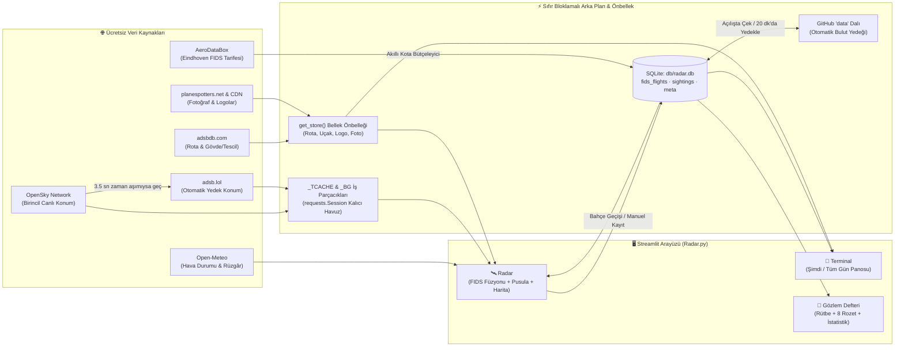

# ✈️ Atlas'ın Uçak Gözlem Kulesi · v0.4.4

Eindhoven Havalimanı (`EHEH` / `EIN`) kuzey yaklaşma koridorunu (pist `03/21`) ve **Blixembosch bahçesinin (`51.4950, 5.4750`)** üzerinden geçen uçakları baba-oğul birlikte canlı izlemek, gökyüzünde hangi yöne bakılacağını görmek ve yakalanan uçakları oyunlaştırılmış bir koleksiyonda biriktirmek için tasarlanmış koyu temalı Streamlit panosu.

> Ayrıntılı teknik mimari ve geliştirici kuralları için ayrıca [`CLAUDE.md`](CLAUDE.md) dosyasına bakabilirsiniz.

---

## 🎯 Temel Özellikler ve Sayfalar

| Sayfa | Ne Gösterir & Nasıl Çalışır? |
|---|---|
| 🛫 **Terminal** *(Varsayılan)* | • **Eindhoven Airport (EIN · EHEH) FIDS Ekranı:** **🛬 Varış** ve **🛫 Kalkış** ayrı panellerde, her yönde varsayılan 20 uçuş (60'a kadar artırılabilir).<br>• **Görünümler:** **Şimdi** (son 60 dk içinde inen/kalkan + aktif + önümüzdeki 30 dk) ve **Tüm gün**.<br>• **Detaylar:** Havayolu logosu, ülke bayrağı, şehir, kapı numarası, **Durum** ve **Gecikme** sütunları, anlık arama çubuğu.<br>• **Asenkron Açılış:** GitHub veya harici servisi beklemeden anında yüklenir. |
| 🛰️ **Radar** | • **Canlı Harita & 500 ms Kayma Animasyonu:** Uçaklar sunucudan yeni veri gelmesini beklemeden hız ve yön vektörlerine göre harita üzerinde akıcı şekilde ilerler.<br>• **Bahçe Önceliği:** Bahçe görüş alanındaki (`≤ 4 km`, `≤ 5.000 ft`) uçaklar otomatik seçilir ve rotası bilinmese bile (askeri, ambulans helikopteri vb.) asla gizlenmez.<br>• **🧭 Gökyüzü Pusulası & Bakış Açısı:** Uçağın evinize göre hangi yönde (*Kuzeydoğu ↗* vb.) ve ufuktan kaç derece yukarıda olduğunu (*"🦅 Tam tepemizde! Başını yukarı kaldır (52°)"*) gösterir.<br>• **🔗 Terminal + Radar Füzyonu:** `adsbdb`'de bulunmayan uçuşların kalkış/varış şehri, saati, rötarı ve kapı (`Gate`) numarası yerel Terminal (`fids_flights`) veritabanından otomatik tamamlanır.<br>• **🧒 Çocuk Dostu Kıyaslamalar:** 50+ uçak tipi için eğlenceli bilgiler ve uçağın hızını/irtifasını *Formula 1 aracı, çita, Eyfel Kulesi veya Burj Khalifa* ile kıyaslayan canlı bilgi kutusu.<br>• **🔔 Bahçe Sesli Uyarısı:** Bahçe üstüne yeni bir uçak girdiğinde tarayıcıda Web Audio API ile çift tonlu kokpit anons çanı (*ding-dong*) çalar.<br>• **📖 Tek Tıkla Deftere Kayıt:** Seçili uçağı istediğiniz an manuel olarak da Gözlem Defteri'ne kaydedebilirsiniz. |
| 📒 **Gözlem Defteri** | • **Otomatik & Manuel Kayıt:** Bahçeden geçen uçaklar otomatik olarak SQLite veritabanına ve GitHub `data` dalına kaydedilir.<br>• **🏅 Uçak Avcısı Rütbesi & 8 Rozetlik Koleksiyon:** Yakalanan uçak sayısına göre 5 rütbe (*🐣 Meraklı Gözlemci → 🏆 Gökyüzü Efsanesi*) ve 8 rozet (*İlk Av, Keskin Göz, Dünya Turu, Filo Uzmanı, Alçak Uçuş, Tam Tepemizde, Sadık Gözcü, Kule Efsanesi*).<br>• **İstatistikler:** Bugün / son 7 gün / toplam uçak, en çok görülen havayolu ve uçak modeli, son 7 gün çubuk grafiği ve son gözlemler tablosu. |


---

## 🧠 Sistemin Çalışma Mantığı ve Veri Akışı



### 1. Sıfır Bloklamalı (Non-Blocking) Performans Mimarisi
Streamlit normalde her tıklamada sayfayı baştan çalıştırır. Uygulamanın bahçede telefon/tabletten anında tepki vermesi için **hiçbir dış ağ çağrısı ana çizim iş parçacığını (UI thread) bekletmez**:
* **İki Aşamalı Radar Güncellemesi (`_traffic_job`):** Arka plan iş parçacığı OpenSky veya `adsb.lol`'dan uçak konumlarını alır almaz `_TCACHE`'e yazar; rota ve logo sorgularını ardından arka planda tamamlar.
* **Stale-While-Revalidate (`allow_stale=True`):** Radar açıkken veri 8 saniyeden (`FETCH_TTL`) eskiyse bile eldeki son geçerli veri **0.01 saniyede** ekrana çizilir, taze veri arka planda çekilir.
* **Kalıcı Bağlantı Havuzu (`_HTTP_SESSION`):** Tüm API çağrıları tek bir `requests.Session()` üzerinden yapılarak tekrarlı SSL/TLS el sıkışma gecikmeleri ortadan kaldırılmıştır.
* **SQLite Bellek İndeksleri:** `meta` tablosu ve Terminal-Radar eşleştirme haritası (`fids_lookup_map`) bellekte önbelleklenir; veritabanına yeni yazma (`_write_seq`) olmadıkça disk sorgusu yapılmaz.

### 2. Üç Kaynaklı Akıllı Uçuş Zenginleştirme (Hybrid Fusion)
Canlı radardaki her uçak (`build_flights`) üç aşamalı bir boru hattından geçer:
1. **`adsbdb` Sorgusu:** `ThreadPoolExecutor(12)` ile çağrı kodundan rota ve ICAO24 hex kodundan uçak modeli/tescili çekilir.
2. **Yerel Terminal (`fids_flights`) Füzyonu (`_match_fids`):** `adsbdb`'nin bilmediği uçuşlar yerel SQLite veritabanındaki Eindhoven tarifesiyle çağrı kodu (`TRA6672`), IATA dönüşümü (`TRA6672 → HV6672`) veya kuyruk tescili (`PH-HXA`) üzerinden eşleştirilir. Böylece uçağın kalkış/varış şehri, kapı (`Gate`) numarası ve rötar bilgisi canlı radara aktarılır.
3. **Askeri / Hava Ambulansı / Polis Koruması (`SPECIAL_PREFIXES`):** Eindhoven Hava Üssü uçakları (`NAF`, `MMF`, `C-130`, `A330 MRTT`), `Lifeliner` (`LIF`, `ANW`) ambulans helikopterleri ve polis helikopterleri (`ZXP`) ticari rotası olmasa bile asla gizlenmez.

### 3. Gökyüzü Pusulası ve Aktif Pist Tahmini
* **Gökyüzü Pusulası (`enrich_geometry`):** Evin koordinatından uçağa olan kerteriz açısını 8 yönlü pusulaya çevirir ve $\arctan(\text{irtifa} / \text{yatay mesafe})$ formülüyle uçağın ufuktan kaç derece yukarıda olduğunu hesaplar.
* **Aktif Pist Tahmini (`infer_runway`):** Havalimanına `10 km` içindeki alçak uçakların baş açısına (`30°` ise **Pist 03**, `210°` ise **Pist 21**), uçak yoksa Open-Meteo rüzgâr yönüne (uçaklar rüzgâra karşı iner/kalkar) göre hangi pistin aktif olduğunu ve uçakların bahçe üzerinden **İniş** mi yoksa **Kalkış** mı yaptığını üst bilgi çubuğunda gösterir.

---

## 🔐 Şifre Kapısı ve Mobil "Beni Hatırla" Anahtarı

* Uygulama açılışta `APP_PASSWORD` şifresini sorar (`APP_PASSWORD` tanımlı değilse güvenlik amacıyla kilitli kalır ve hiçbir API çağrısı yapılmaz).
* Giriş yapıldıktan sonra adres çubuğuna güvenli bir HMAC özeti (`?k=...`) eklenir.
* **İpucu:** Giriş yaptıktan sonra oluşan bu URL'yi telefon veya tabletinizin ana ekranına / yer imlerine eklerseniz, bahçede uçak geçerken tekrar şifre yazmadan doğrudan Radar ekranına girebilirsiniz.

---

## 🛫 Terminal Ekranı ve Akıllı AeroDataBox Kota Yönetimi

1. RapidAPI üzerinden **AeroDataBox** (Basic / ücretsiz plan, ayda ~600 birim) aboneliği alın ve `AERODATABOX_KEY` olarak secrets'a ekleyin.
2. **Kota Koruma Mantığı (`radar_fids.py`):**
   * Her yenileme `withLeg=true` ile 12 saatlik tüm varış ve kalkışları tek seferde çeker (2 birim harcar).
   * Aylık kotanın `%10`'u güvenlik payı olarak ayrılır. Kalan gün ve kalan birime göre yenileme sıklığı (`1 saat – 12 saat`) dinamik hesaplanır.
   * Gece `00:00–05:00` saatleri arasında Eindhoven'da uçuş olmadığı için otomatik sorgu yapılmaz.

---

## 💾 Veritabanı (`SQLite`) ve GitHub `data` Dalı Kalıcılığı

Streamlit Community Cloud yeniden başladığında yerel disk sıfırlanır. Veri kaybını önlemek için `db/radar.db` dosyası GitHub deposunun **`data` dalında** (`orphan branch`) saklanır:
* **Şema ([`db/schema.sql`](db/schema.sql)):** `meta`, `fids_flights` (tarife), `sightings` (gözlem defteri), `api_usage` (aylık kota), `fetch_log`.
* **Açılışta Arka Plan Çekme:** Uygulama açılırken ekranı bekletmeden `data` dalındaki veritabanını indirir; bu sırada yerel kayıt oluşmuşsa `merge_from()` ile iki veritabanını kayıpsız birleştirir.
* **Otomatik Yedekleme:** Değişiklik varsa en çok 20 dakikada bir arka planda GitHub `data` dalına yazılır (veya Gözlem Defteri'ndeki **☁️ Şimdi yedekle** düğmesiyle anında yedeklenir). `data` dalına yazmak `main` dalını tetiklemediği için uygulamayı yeniden başlatmaz.

---

## ⚙️ Kurulum ve Yapılandırma

```bash
python -m venv .venv && source .venv/bin/activate
pip install -r requirements.txt
cp .streamlit/secrets.toml.example .streamlit/secrets.toml   # anahtarlarınızı girin
streamlit run Radar.py
```

### Secrets (`secrets.toml`) Parametreleri

| Secret | Zorunlu mu? | Açıklama |
|---|---|---|
| `APP_PASSWORD` | **Evet** | Uygulama giriş şifresi |
| `AERODATABOX_KEY` | Önerilir | Eindhoven Terminal tarifesi ve Radar-FIDS rota eşleştirmesi için RapidAPI anahtarı |
| `AERODATABOX_HOST`, `ADB_MONTHLY_UNITS` | İsteğe bağlı | Varsayılan: `aerodatabox.p.rapidapi.com`, aylık `600` birim |
| `GITHUB_TOKEN`, `GITHUB_REPO`, `DATA_BRANCH`, `DB_PUSH_MIN` | Önerilir | SQLite veritabanını GitHub `data` dalına yedeklemek için Fine-Grained Token (*Contents: Read & Write*) |
| `opensky_client_id`, `opensky_client_secret` | İsteğe bağlı | OpenSky OAuth2 hesabı (yoksa anonim + `adsb.lol` otomatik yedek kullanılır) |
| `TRAFFIC_SOURCE` | İsteğe bağlı | `auto` (varsayılan: OpenSky → `adsb.lol`), `opensky` veya `adsblol` |
| `HOME_LAT`, `HOME_LON` | İsteğe bağlı | Ev koordinatı (depo herkese açıksa koordinatı kod yerine burada tutun) |

---

## 🧪 Test Paketi

İnternet bağlantısı gerektirmeden tüm birim, entegrasyon ve performans bütçesi testlerini çalıştırmak için:

```bash
bash tests/run_all.sh
```

* `tests/test_db_auth.py`: SQLite şeması, FIDS/Sightings birleştirme, GitHub `data` dalı senkronizasyonu ve şifre kapısı.
* `tests/test_fids.py` & `tests/test_newformat.py` & `tests/test_window.py`: AeroDataBox ayrıştırıcısı, kota bütçeleyicisi ve "Şimdi" penceresi.
* `tests/test_app.py` & `tests/test_radar_flow.py`: Radar filtreleri, harita işaretçileri, gözlem defteri ve sayfa geçişleri.
* `tests/test_default_page.py`: Varsayılan Radar açılışı, `?k=` URL token ile giriş, FIDS-Radar birleştirmesi, Gökyüzü Pusulası, çocuk dostu kıyaslamalar ve rozet koleksiyonu.
* `tests/test_perf.py`: Gerçekçi ağ gecikmeleri altında soğuk/sıcak açılış ve sayfa geçiş süre bütçeleri.
